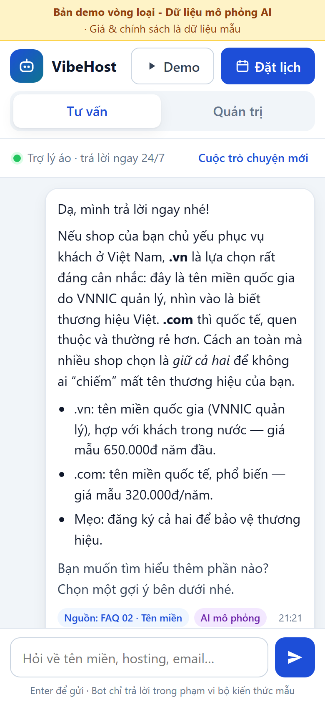
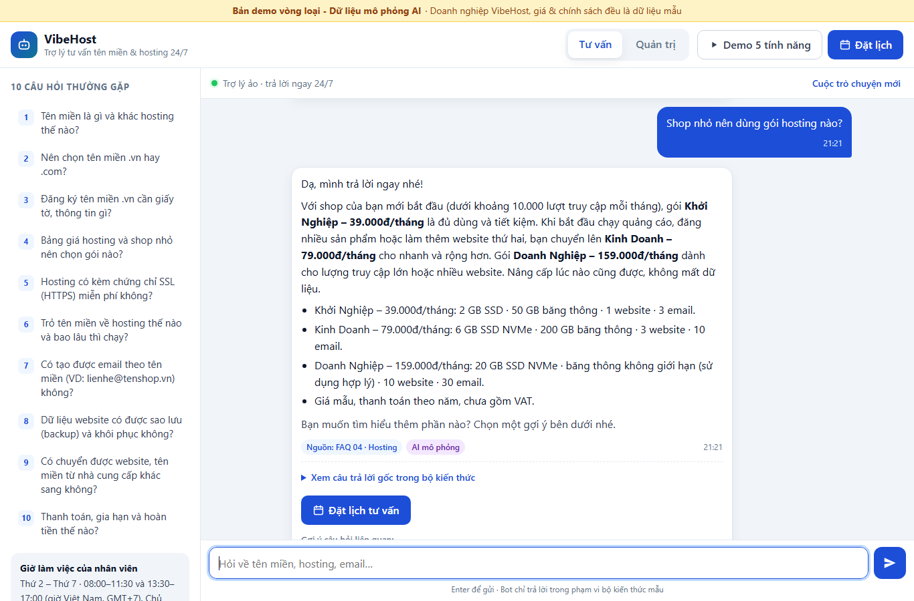
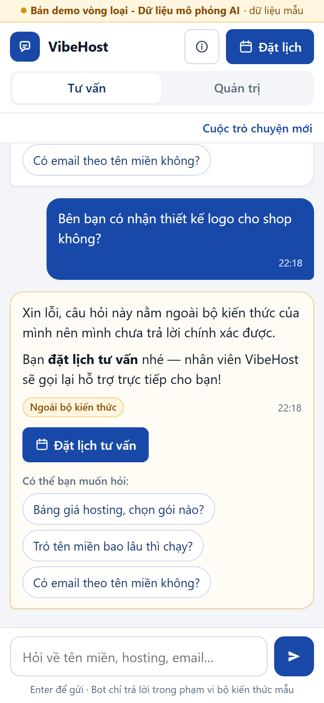
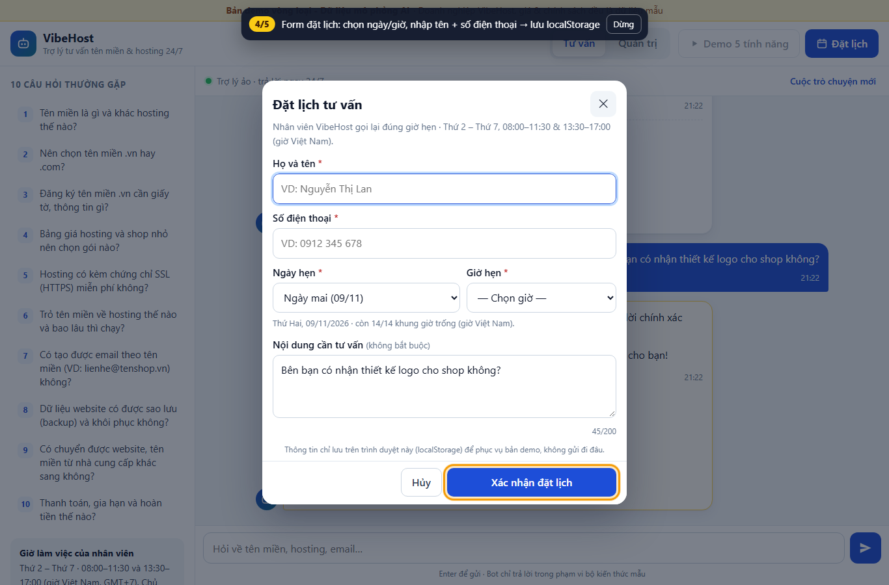
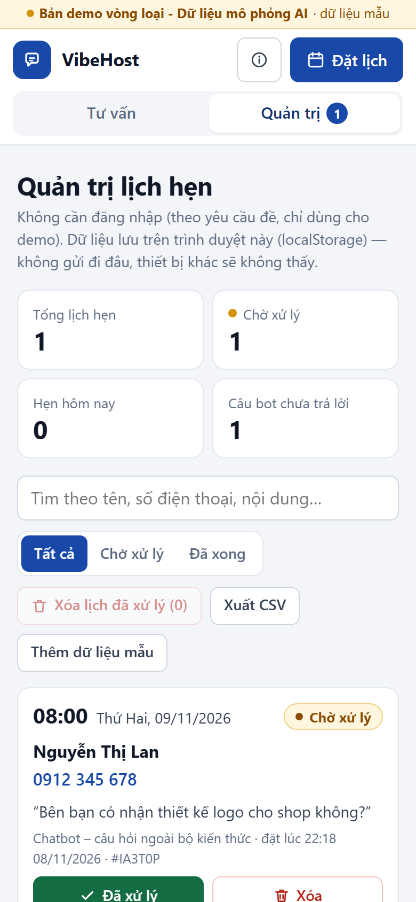
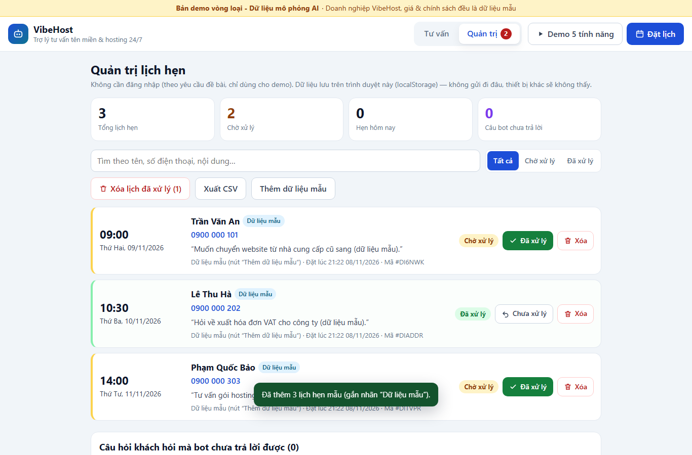

# VibeHost Chatbot — Chatbot FAQ & đặt lịch tư vấn — Cuộc thi Vibe Coding 2026

> **Bản demo vòng loại - Dữ liệu mô phỏng AI.** "VibeHost" là doanh nghiệp giả định. Toàn bộ câu hỏi, giá, thông số gói và chính sách trong sản phẩm là **dữ liệu mẫu do đội tự xây dựng**, không phải thông tin của nhà tài trợ hay của công ty có thật nào.

## 1. Thông tin chung

| Hạng mục | Nội dung |
|---|---|
| Tên đội thi | Vibe |
| Bảng thi | Bảng B - Kinh tế |
| Đề bài bốc thăm | Đề số 4 — Chatbot FAQ & đặt lịch tư vấn |
| Demo online | https://khoa-nhd.github.io/vibe-coding-2026-de4-chatbot/ (hoặc mở `index.html` từ source) |
| Video demo (≤ 02 phút) | https://khoa-nhd.github.io/vibe-coding-2026-de4-chatbot/video.html (1 phút 30 giây; file gốc: `media/demo-de4.webm` trên repo) |
| Source ZIP | https://github.com/khoa-nhd/vibe-coding-2026-de4-chatbot/releases/latest/download/Vibe_De4_ChatbotFAQ_source.zip |
| Minh chứng dùng AI | Kèm trong ZIP: [`docs/MINH-CHUNG-AI.md`](docs/MINH-CHUNG-AI.md) |
| Bảng kiểm thử | Kèm trong ZIP: [`docs/KIEM-THU.md`](docs/KIEM-THU.md) và mục 11 bên dưới |

> Tiêu chí vòng loại: https://vibecoding.info.vn/tieu-chi-cham-thi
> Bảng B: ít nhất 3 ca kiểm thử; AI thật hoặc Mock minh bạch đều có thể đạt 100/100 theo chuẩn bảng B.
> Không đưa khóa API hoặc mật khẩu vào bài nộp — sản phẩm này **không dùng khóa API nào**.

### Bài toán và người dùng (tình huống cụ thể)

Chị Lan bán quần áo online, đang tìm chỗ mua tên miền và hosting cho shop. 22 giờ tối chị nhắn hỏi "nên chọn .vn hay .com", "SSL có miễn phí không" — doanh nghiệp nhỏ như VibeHost **không có nhân viên trực đêm**.

- **Chatbot trả lời ngay 24/7** 10 câu hỏi thường gặp nhất, diễn đạt tự nhiên, kèm 3 câu hỏi gợi ý để chị tìm hiểu tiếp.
- Khi chị hỏi điều **nằm ngoài bộ kiến thức** (VD: "có nhận thiết kế logo không?"), bot **không đoán mò** mà chủ động mời **đặt lịch**: chị chọn ngày/giờ, để lại tên + số điện thoại.
- **Sáng hôm sau**, nhân viên mở trang **Quản trị**: thấy lịch hẹn kèm câu hỏi gốc, gọi lại, bấm **Đã xử lý** rồi **Xóa**. Danh sách "câu hỏi bot chưa trả lời được" giúp chủ shop biết nên bổ sung FAQ nào.

Lợi ích: không bỏ lỡ khách ngoài giờ, nhân viên không phải trả lời lặp lại cùng một câu, mỗi câu hỏi khó đều thành một lịch hẹn có thể chăm sóc.

## 2. Tính năng chính

- **Tính năng 1 — Khung chat trả lời 10 câu hỏi thường gặp** từ bộ kiến thức có sẵn (`js/data.js`). Hiểu cả câu **gõ không dấu** ("ssl co mien phi khong"), **gõ sai nhẹ** ("domian", "hostng", "bakup"), câu viết theo nhiều cách; có cột 10 chủ đề (máy tính) và lệnh "Xem 10 câu hỏi".
- **Tính năng 2 — AI diễn đạt lại câu trả lời + gợi ý 03 câu hỏi liên quan sau mỗi lượt** (AI mô phỏng – mock): câu trả lời được viết lại theo giọng tư vấn, cá nhân hóa theo ngữ cảnh khách nhắc tới ("shop của bạn", "website doanh nghiệp của bạn"), hỏi lại thì dùng cách diễn đạt khác. Mỗi câu trả lời có nhãn **"Nguồn: FAQ … · AI mô phỏng"** và nút **"Xem câu trả lời gốc"** để phân biệt dữ liệu mẫu với phần mô phỏng.
- **Tính năng 3 — Không trả lời được → chủ động đề xuất đặt lịch**: khi độ khớp thấp hơn ngưỡng hoặc câu hỏi có dấu hiệu ngoài phạm vi, bot xin lỗi, không bịa câu trả lời, hiện nút **Đặt lịch tư vấn** (form tự điền sẵn câu hỏi của khách) và ghi câu đó vào nhật ký cho quản trị. Hỏi ngoài phạm vi 2 lần liên tiếp → bot nhấn mạnh gặp chuyên viên. Khách nói "muốn gặp nhân viên / đặt lịch" → form mở ngay.
- **Tính năng 4 — Form đặt lịch**: chọn ngày (hôm nay → 14 ngày tới, Chủ nhật nghỉ) và khung giờ 30 phút trong giờ làm việc (giờ Việt Nam), nhập tên + số điện thoại; kiểm tra dữ liệu, chặn giờ đã qua, chặn trùng khung giờ, chặn một số điện thoại đặt 2 lịch chờ trong cùng ngày; lưu danh sách lịch hẹn vào **localStorage** rồi đọc lại để xác nhận.
- **Tính năng 5 — Trang quản trị đơn giản** (không cần đăng nhập): xem danh sách lịch hẹn sắp theo ngày giờ, thống kê, tìm kiếm, lọc; **đánh dấu Đã xử lý** và **xóa lịch đã xử lý** (từng lịch hoặc tất cả, có hộp xác nhận); xem câu hỏi bot chưa trả lời được; xuất CSV; nút "Thêm dữ liệu mẫu" (gắn nhãn *Dữ liệu mẫu*).
- **Tiện ích demo**: nút **▶ Demo 5 tính năng** tự chạy lần lượt cả 5 tính năng trên chính giao diện thật (~80 giây, có chú thích 1/5 … 5/5) — dùng để quay video và để giám khảo xem nhanh.

### Bộ 10 câu hỏi mẫu (bộ kiến thức — dữ liệu mẫu, chủ đề hosting/domain theo gợi ý BTC)

| # | Nhóm | Câu hỏi | Tóm tắt câu trả lời gốc |
|---|---|---|---|
| 1 | Kiến thức cơ bản | Tên miền là gì và khác hosting thế nào? | Tên miền là địa chỉ (tenshop.vn), hosting là nơi lưu website; cần cả hai và trỏ tên miền về hosting. |
| 2 | Tên miền | Nên chọn tên miền .vn hay .com? | .vn là tên miền quốc gia do VNNIC quản lý, hợp với khách trong nước; .com quốc tế, phổ biến; nên giữ cả hai. Giá mẫu: .vn 650.000đ năm đầu, .com 320.000đ/năm. |
| 3 | Tên miền | Đăng ký tên miền .vn cần giấy tờ, thông tin gì? | Cá nhân: thông tin định danh (căn cước/CCCD)…; tổ chức: tên, mã số thuế, địa chỉ, người đại diện. Theo Nghị định 147/2024/NĐ-CP, thông tin phải chính xác, sai có thể bị tạm ngừng/thu hồi. |
| 4 | Hosting | Bảng giá hosting và shop nhỏ nên chọn gói nào? | 3 gói mẫu: Khởi Nghiệp 39.000đ/tháng, Kinh Doanh 79.000đ/tháng, Doanh Nghiệp 159.000đ/tháng (SSD, băng thông, số website, email). Shop nhỏ bắt đầu từ Khởi Nghiệp. |
| 5 | Bảo mật | Hosting có kèm chứng chỉ SSL (HTTPS) miễn phí không? | Có, SSL Let’s Encrypt miễn phí, tự gia hạn; thiếu SSL trình duyệt báo "Không bảo mật". |
| 6 | Kỹ thuật | Trỏ tên miền về hosting thế nào và bao lâu thì chạy? | Đổi nameserver hoặc tạo bản ghi A; thường vài phút – vài giờ, tối đa 24–48 giờ để DNS cập nhật. |
| 7 | Email | Có tạo được email theo tên miền không? | Có: 3/10/30 hộp thư theo gói (mẫu), dùng webmail/Outlook, cần bản ghi MX. |
| 8 | Bảo mật | Dữ liệu website có được sao lưu và khôi phục không? | Có: hằng tuần (giữ 4 bản) hoặc hằng ngày (giữ 7/14 bản) theo gói — chính sách mẫu. |
| 9 | Chuyển đổi | Có chuyển được website, tên miền từ nhà cung cấp khác sang không? | Hỗ trợ chuyển website (mẫu); .com cần mã EPP, thường chưa chuyển được trong 60 ngày sau đăng ký/chuyển (ICANN); .vn theo quy trình VNNIC. |
| 10 | Thanh toán | Thanh toán, gia hạn và hoàn tiền thế nào? | Chuyển khoản/QR/ví điện tử (mẫu); nhắc gia hạn trước 30/15/7 ngày; hoàn tiền hosting 7 ngày đầu, tên miền không hoàn sau khi đăng ký (chính sách mẫu). |

Ngoài 10 câu trên, bot nhận biết một số ý định hội thoại cơ bản: chào hỏi, cảm ơn, tạm biệt, "bạn là ai", giờ làm việc, muốn gặp nhân viên/đặt lịch, xem danh sách câu hỏi.

### Bảng trạng thái tính năng (phân biệt dữ liệu thật – mẫu – mô phỏng)

| Phần | Trạng thái |
|---|---|
| Bộ kiến thức 10 FAQ, bảng giá, chính sách | **Dữ liệu mẫu** do đội soạn (doanh nghiệp giả định) |
| Diễn đạt lại câu trả lời, gợi ý 3 câu hỏi | **Mô phỏng AI (mock)** theo quy tắc, có nhãn trên giao diện |
| Chọn câu trả lời (so khớp từ khóa), phát hiện câu ngoài phạm vi | Hoạt động thật (chạy trên trình duyệt) |
| Đặt lịch, kiểm tra dữ liệu, lưu localStorage, trang quản trị | Hoạt động thật (lưu trên trình duyệt đang dùng) |
| Gọi AI thật (LLM), gửi SMS/email xác nhận, đồng bộ nhiều thiết bị, đăng nhập quản trị | Chưa triển khai (ngoài phạm vi vòng loại) |

## 3. Công nghệ sử dụng

| Lớp | Công nghệ (ghi đúng thứ đã dùng) |
|---|---|
| Giao diện | HTML/CSS/JS thuần (không framework), CSS tự viết, mobile-first |
| Thư viện | Không dùng thư viện hay CDN bên ngoài (icon là SVG tự vẽ) → chạy được offline |
| Lưu trữ | localStorage (phía trình duyệt, không có backend) |
| Triển khai | GitHub Pages (tĩnh); hoặc mở trực tiếp `index.html` từ source |
| Kiểm thử | `node tests/run-tests.js` (Node.js ≥ 18, không cần cài gói) + kiểm thử giao diện trên trình duyệt Edge |

## 4. Tích hợp AI

- **Chế độ đang dùng**: **Mock**
  - Mock: giao diện hiển thị dòng *"Bản demo vòng loại - Dữ liệu mô phỏng AI"* (banner cố định trên cùng) và nhãn **"AI mô phỏng"** trên từng câu trả lời.
- **Mục đích**: diễn đạt lại câu trả lời gốc trong bộ kiến thức cho tự nhiên và gợi ý 3 câu hỏi liên quan theo ngữ cảnh đề bài.
- **Cách mock hoạt động (minh bạch)** — `js/engine.js`:
  1. Chuẩn hóa câu hỏi (bỏ dấu tiếng Việt, sửa lỗi gõ nhẹ cho từ kỹ thuật), chấm điểm khớp với từ khóa của từng FAQ (cụm nhiều từ được điểm cao hơn; từ quá chung như "giá", "bao lâu" chỉ được điểm thấp).
  2. Điểm ≥ 2,0 → lấy **câu trả lời gốc** của FAQ đó; điểm thấp hơn, hoặc câu có dấu hiệu ngoài phạm vi (logo, quảng cáo, vé máy bay, bị hack, spam…) mà không khớp mạnh (≥ 3,0) → **không trả lời**, mời đặt lịch.
  3. "Diễn đạt lại": chọn 1 trong 2 mẫu câu tự nhiên đã soạn cho FAQ (xoay vòng khi khách hỏi lại), thêm câu mở/kết, thay ngữ cảnh khách nhắc tới. **Mock không tạo thông tin mới** — nội dung luôn bám câu gốc; nút "Xem câu trả lời gốc" cho thấy câu gốc, từ khóa đã khớp và điểm.
  4. Gợi ý 3 câu: ưu tiên danh sách liên quan chưa hỏi → cùng nhóm → phổ biến; luôn đúng 3 câu, không trùng câu vừa hỏi.
- **Hướng nâng cấp lên AI thật** (chưa làm ở vòng loại): giữ nguyên bước chọn FAQ; chỉ thay bước 3 bằng một LLM gọi qua serverless function/proxy, prompt ràng buộc: *"Chỉ diễn đạt lại CÂU TRẢ LỜI GỐC bên dưới bằng tiếng Việt thân thiện, không thêm số liệu hay chính sách mới; trả về JSON {answer, suggestions[3]}"*; kiểm tra đầu ra (đủ 3 gợi ý, không chứa con số lạ) và quay về mock nếu lỗi/quá thời gian.
- **Bảo mật khoá API**: bản này không dùng khóa API nào. Nếu nâng cấp: khóa đặt trong biến môi trường của serverless function, không ghi vào mã phía client, không commit.

## 5. Cài đặt và chạy local

Yêu cầu: trình duyệt hiện đại (Chrome, Edge, Firefox, Safari bản mới). Không cần cài đặt gì.

**Cách A — HTML/CSS/JS thuần**

1. Giải nén file ZIP.
2. Mở trực tiếp `index.html` trên trình duyệt (bấm đúp), hoặc chạy server tĩnh: `npx serve .`
3. (Tuỳ chọn) Chạy kiểm thử logic: `node tests/run-tests.js` → kết quả "Đạt 278/278 kiểm tra".

Gợi ý dùng thử nhanh: bấm **▶ Demo 5 tính năng** trên thanh trên cùng, hoặc tự hỏi "nên chọn .vn hay .com", "ssl co mien phi khong", "có nhận thiết kế logo không?" rồi đặt lịch và sang tab **Quản trị**.

## 6. Cấu trúc thư mục

```text
vibe-de4-chatbot-faq/
├── index.html            # giao diện 2 màn hình: Tư vấn (#/chat) và Quản trị (#/admin)
├── css/styles.css        # giao diện mobile-first
├── js/
│   ├── data.js           # bộ kiến thức 10 FAQ + dữ liệu mẫu doanh nghiệp (VibeHost giả định)
│   ├── engine.js         # chuẩn hóa tiếng Việt, so khớp, AI mô phỏng (diễn đạt + 3 gợi ý)
│   ├── booking.js        # khung giờ (giờ VN), kiểm tra form, lưu lịch hẹn localStorage, CSV
│   └── app.js            # khung chat, form đặt lịch, trang quản trị, demo tự động
├── tests/run-tests.js    # 278 kiểm tra logic, chạy bằng Node, không cần cài gói
├── docs/
│   ├── KIEM-THU.md       # bảng kiểm thử (12 ca) + kết quả thực tế
│   ├── MINH-CHUNG-AI.md  # minh chứng dùng AI để xây dựng và cải thiện
│   └── screenshots/      # ảnh chụp giao diện điện thoại & máy tính
└── README.md
```

Trên repo GitHub còn có `video.html` và `media/demo-de4.webm` (video demo). Hai file này không đóng vào Source ZIP cho gọn.

## 7. Truy cập và phân quyền

- Không yêu cầu đăng nhập; chuyển đổi giữa màn hình người dùng (**Tư vấn**) và màn hình quản trị (**Quản trị**) ngay trên thanh điều hướng.
- Màn hình quản trị: xem, đánh dấu đã xử lý và xoá lịch hẹn trong localStorage; xem/xóa nhật ký câu hỏi chưa trả lời; xuất CSV.

## 8. Giới hạn hiện tại

- Dữ liệu chỉ lưu trên trình duyệt hiện tại; xoá dữ liệu trình duyệt hoặc đổi thiết bị sẽ mất dữ liệu. Nhân viên và khách không dùng chung một danh sách (cần backend nếu triển khai thật).
- Không có xác thực, nên màn hình quản trị không bảo mật (đúng phạm vi đề bài cho vòng loại).
- Tính năng AI ở mức demo (Mock): bot chỉ hiểu các câu gần với 10 chủ đề đã soạn; câu hỏi khác sẽ được chuyển sang đặt lịch. Diễn đạt dựa trên mẫu câu soạn sẵn, không phải AI thật sinh ra.
- Giá, thông số, chính sách là dữ liệu mẫu; thông tin pháp lý (Nghị định 147/2024/NĐ-CP, quy định ICANN) chỉ tóm tắt ở mức tham khảo.
- Hai người đặt cùng một khung giờ ở hai tab cùng lúc: hệ thống đọc lại dữ liệu ngay khi lưu nên chặn được trên cùng trình duyệt, nhưng không xử lý được giữa nhiều thiết bị.

## 9. Nguồn tham khảo

- Đề bài, tiêu chí chấm, mẫu README của BTC: https://vibecoding.info.vn/de-bai · https://vibecoding.info.vn/tieu-chi-cham-thi
- Nghị định 147/2024/NĐ-CP về quản lý, cung cấp, sử dụng dịch vụ Internet và thông tin trên mạng (hiệu lực 25/12/2024) — phần đăng ký tên miền ".vn".
- Trung tâm Internet Việt Nam (VNNIC) — quản lý tên miền quốc gia ".vn".
- ICANN Transfer Policy — quy định khóa chuyển tên miền 60 ngày sau đăng ký/chuyển (đang áp dụng).
- Let’s Encrypt — chứng chỉ SSL/TLS miễn phí; MDN Web Docs — `localStorage`, `<dialog>`.
- Không dùng thư viện, template hay hình ảnh bên ngoài; Google Fonts/Lucide **không** dùng.

## 10. Minh chứng dùng AI để xây dựng sản phẩm

Chi tiết (≤ 1 trang, 5 đoạn hội thoại chọn lọc): [`docs/MINH-CHUNG-AI.md`](docs/MINH-CHUNG-AI.md). Công cụ: **Claude Code** (trợ lý lập trình AI). Đội giao yêu cầu và chốt quyết định (dùng mock minh bạch, doanh nghiệp giả định, deploy GitHub Pages); AI đọc đề, viết mã, tự chạy thử, phát hiện lỗi và sửa; đội duyệt kết quả.

Tóm tắt một vòng thử và cải thiện: thử 40 câu hỏi kiểu khách thật → phát hiện 3 câu bị trả lời **sai chủ đề** (VD "hoàn tiền mất bao lâu" bị trả lời bằng FAQ "trỏ tên miền" vì cụm "mất bao lâu" được điểm quá cao) → yêu cầu AI sửa trọng số từ khóa, thêm dấu hiệu ngoài phạm vi → chạy lại: cả 3 câu đúng, thêm kiểm tra hồi quy, toàn bộ kiểm thử đạt.

## 11. Bảng kiểm thử

Bảng B yêu cầu ít nhất 3 ca (bình thường, nhập thiếu/sai, ca biên) — đội làm **12 ca**. Thực hiện ngày 08/11/2026 trên trình duyệt Microsoft Edge (cỡ điện thoại 390×844 và máy tính 1366×900, thao tác được tự động hóa để lặp lại chính xác) và bằng `node tests/run-tests.js`. Chi tiết từng bước: [`docs/KIEM-THU.md`](docs/KIEM-THU.md).

| Mã ca | Loại ca | Dữ liệu và bước thử | Kỳ vọng | Kết quả thực tế | Đạt/Chưa đạt |
|---|---|---|---|---|---|
| TC01 | Bình thường | Hỏi "Nên chọn tên miền .vn hay .com cho shop online?" | Trả lời FAQ 02, diễn đạt tự nhiên, có 3 gợi ý | Trả lời FAQ 02 có nhãn "AI mô phỏng", câu gốc, 3 gợi ý; dùng "shop của bạn" | Đạt |
| TC02 | Bình thường (không dấu/gõ sai) | "ssl co mien phi khong", "domian la gi" | Hiểu đúng FAQ 05 và FAQ 01 | Trả lời đúng FAQ 05 và FAQ 01 (tự sửa domian → domain) | Đạt |
| TC03 | Bình thường | Bấm 1 câu gợi ý dưới câu trả lời | Trả lời câu đó + 3 gợi ý mới, không trùng câu vừa hỏi | Trả lời đúng, 3 gợi ý mới; 10 FAQ đều đủ 3 gợi ý | Đạt |
| TC04 | Ngoài phạm vi | "Bên bạn có nhận thiết kế logo cho shop không?" | Không bịa câu trả lời; mời đặt lịch; ghi nhật ký | Hiện "Ngoài bộ kiến thức" + nút Đặt lịch; form điền sẵn câu hỏi; nhật ký quản trị có câu này | Đạt |
| TC05 | Nhập sai/ca biên | Gửi tin chỉ có khoảng trắng; dán tin 400 ký tự | Không gửi tin rỗng; tin dài rút còn 300 ký tự | Không gửi + nhắc "Bạn chưa nhập câu hỏi nào"; tin dài rút còn 300 ký tự + thông báo | Đạt |
| TC06 | Nhập thiếu | Mở form đặt lịch, bấm "Xác nhận" khi chưa nhập | Báo lỗi từng ô, không lưu | Báo lỗi tên, SĐT, giờ ngay dưới ô; localStorage vẫn trống | Đạt |
| TC07 | Nhập sai | Tên "Lan123", SĐT "12345" | Báo lỗi định dạng | "Họ tên chỉ gồm chữ cái…", "Số điện thoại chưa đúng định dạng…" | Đạt |
| TC08 | Ca biên (ngày) | Chọn Chủ nhật; ép chọn ngày hôm qua / 20 ngày tới bằng script | Không cho chọn; nếu ép vẫn bị chặn | Danh sách ngày chỉ có 15 ngày, Chủ nhật ghi "nghỉ" và bị khóa; ép chọn → báo lỗi tương ứng | Đạt |
| TC09 | Ca biên (giờ) | Hôm nay lúc 09:10, chọn khung 09:00/09:30 | Khung đã qua bị khóa (cần đặt trước 30 phút) | 08:00–09:30 bị khóa "đã qua", 10:00 còn trống (kiểm tra logic) | Đạt |
| TC10 | Ca biên (trùng lịch) | Đặt lịch khung đã có người đặt (ép chọn bằng script) | Khung hiện "đã có lịch"; lưu bị chặn | Khung bị khóa "đã có lịch"; ép chọn → lỗi "đã có khách đặt", vẫn chỉ 1 lịch | Đạt |
| TC11 | Bình thường (quản trị) | Đặt lịch đúng → tải lại trang → Quản trị → Đã xử lý → Xóa | Lịch còn sau khi tải lại; xử lý & xóa đúng | Lịch còn sau tải lại; trạng thái "Đã xử lý"; hộp xác nhận → xóa khỏi localStorage | Đạt |
| TC12 | Sự cố dữ liệu | Ghi chuỗi hỏng vào localStorage rồi mở lại | Không treo; báo lỗi; sao lưu bản lỗi | App chạy bình thường, thông báo "lỗi định dạng… đã khởi tạo lại", có bản sao lưu | Đạt |

Kiểm thử tự động bổ sung: `node tests/run-tests.js` → **278/278** kiểm tra đạt (so khớp 50+ cách hỏi, 13 câu ngoài phạm vi, form, lưu trữ, CSV); kiểm thử giao diện trên Edge: **47/47** kiểm tra đạt, 0 lỗi console, không tràn ngang ở 390px, demo tự động chạy 79 giây.

## 12. Hồ sơ bàn giao

- Source ZIP chứa mã nguồn và README này; không có cấu hình bí mật (không dùng khóa API).
- Video 1 phút 30 giây (≤ 2 phút) thể hiện thao tác thực tế và đủ 5 tính năng: quay trực tiếp bản online, nút "▶ Demo 5 tính năng" thao tác lần lượt trên giao diện thật, có khung tiêu đề ở đầu và tóm tắt 5 tính năng ở cuối. Xem tại https://khoa-nhd.github.io/vibe-coding-2026-de4-chatbot/video.html (video để riêng trên repo/Release, không đóng vào Source ZIP cho gọn).
- Minh chứng dùng AI và bảng kiểm thử nằm trong ZIP (`docs/`).
- Dữ liệu demo: không cần tài khoản; bấm "Thêm dữ liệu mẫu" ở trang Quản trị để có sẵn 3 lịch hẹn mẫu (gắn nhãn "Dữ liệu mẫu"); "Đặt lại toàn bộ dữ liệu demo" để xóa sạch.
- Bản nộp trước hạn là căn cứ chấm; không sửa tính năng sau hạn nộp.

| Màn hình | Điện thoại (390px) | Máy tính |
|---|---|---|
| Trả lời FAQ + 3 gợi ý |  |  |
| Ngoài phạm vi → đặt lịch |  |  |
| Quản trị |  |  |
