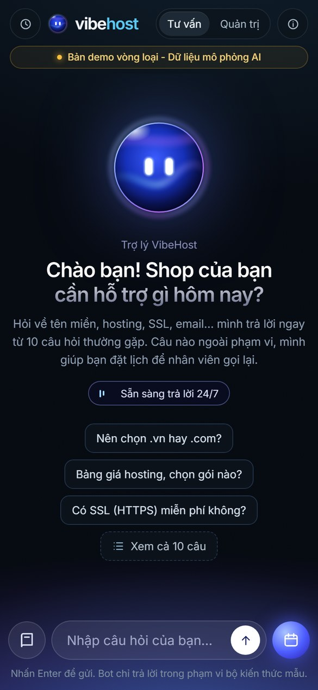
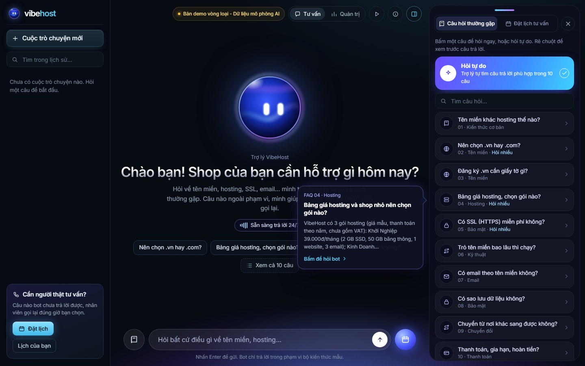
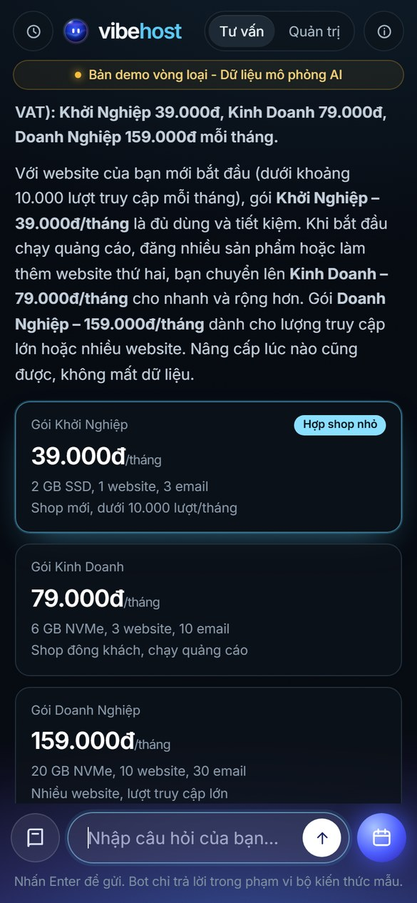
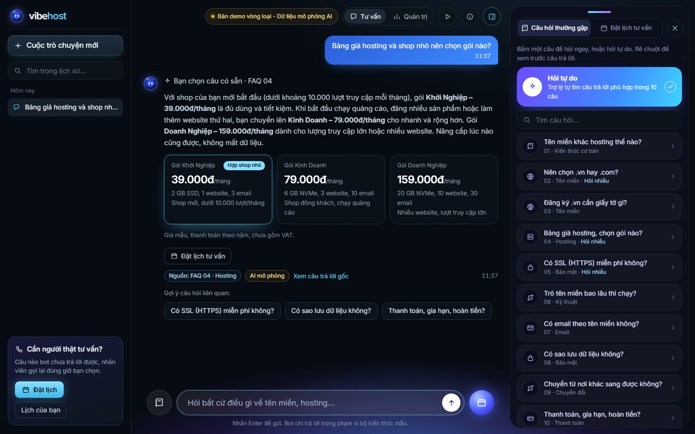
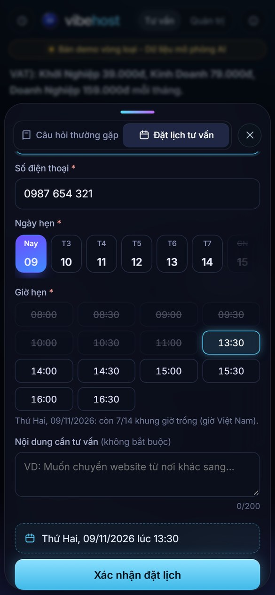
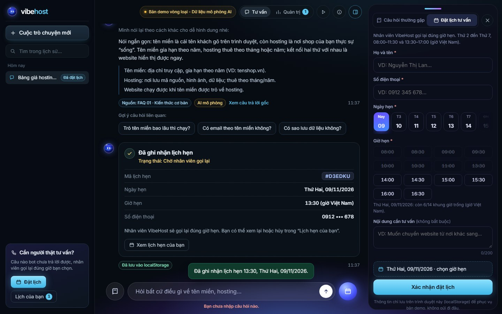
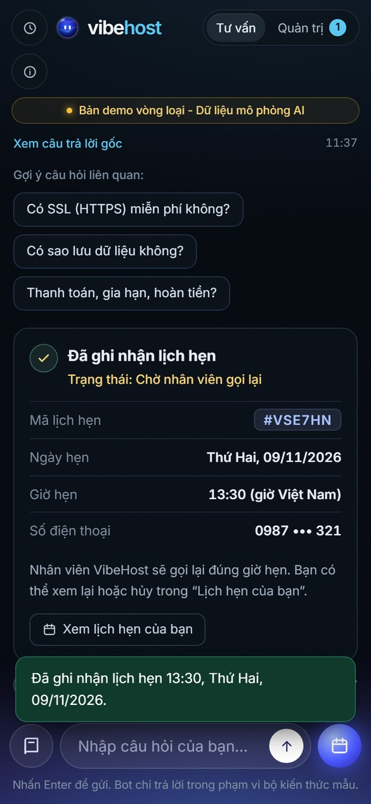
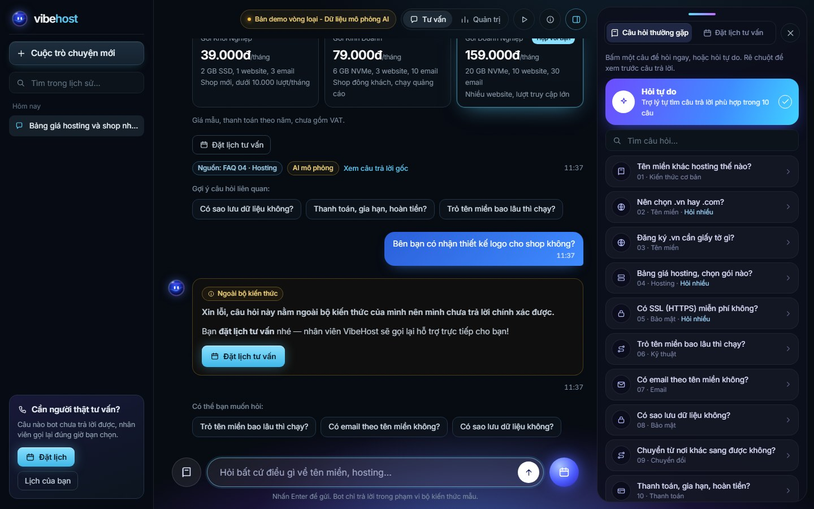
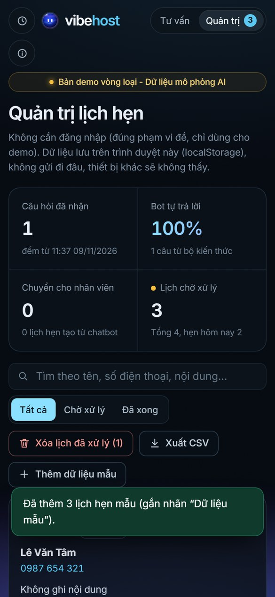
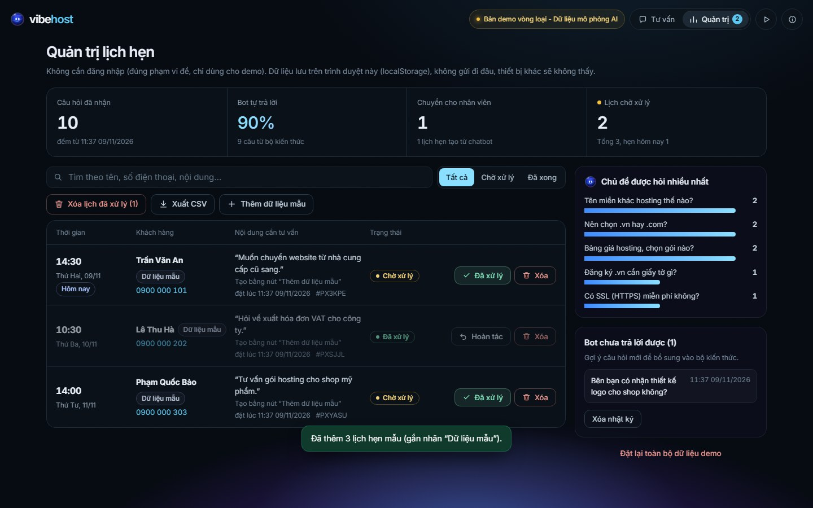

# VibeHost Chatbot — Chatbot FAQ & đặt lịch tư vấn — Cuộc thi Vibe Coding 2026

> **Bản demo vòng loại - Dữ liệu mô phỏng AI.** "VibeHost" là doanh nghiệp giả định. Toàn bộ câu hỏi, giá, thông số gói và chính sách trong sản phẩm là **dữ liệu mẫu do đội tự xây dựng**, không phải thông tin của nhà tài trợ hay của công ty có thật nào. Phiên bản 2.0 — 09/11/2026.

**Dùng thử trong 60 giây:** mở https://khoa-nhd.github.io/vibe-coding-2026-de4-chatbot/ → rê chuột vào một câu ở bảng **Câu hỏi thường gặp** bên phải (bong bóng xem trước câu trả lời) rồi bấm câu đó → hỏi *"ten mien .com gia bao nhieu"* (không dấu) → bấm một câu gợi ý → hỏi *"có nhận thiết kế logo không"* → bấm **Đặt lịch tư vấn** (bảng phải chuyển sang form đặt lịch) → sang tab **Quản trị**. Hoặc bấm nút ▶ trên thanh trên cùng / **Giới thiệu → Chạy demo tự động 5 tính năng**.

## 1. Thông tin chung

| Hạng mục | Nội dung |
|---|---|
| Tên đội thi | Vibe |
| Bảng thi | Bảng B - Kinh tế |
| Đề bài bốc thăm | Đề số 4 — Chatbot FAQ & đặt lịch tư vấn |
| Demo online | https://khoa-nhd.github.io/vibe-coding-2026-de4-chatbot/ (hoặc mở `index.html` từ source) |
| Video demo (≤ 02 phút) | https://khoa-nhd.github.io/vibe-coding-2026-de4-chatbot/video.html (1 phút 41 giây) |
| Source ZIP | https://github.com/khoa-nhd/vibe-coding-2026-de4-chatbot/releases/latest/download/Vibe_De4_ChatbotFAQ_source.zip |
| Minh chứng dùng AI | Kèm trong ZIP: [`docs/MINH-CHUNG-AI.md`](docs/MINH-CHUNG-AI.md) |
| Bảng kiểm thử | Kèm trong ZIP: [`docs/KIEM-THU.md`](docs/KIEM-THU.md) và mục 11 bên dưới |

> Tiêu chí vòng loại: https://vibecoding.info.vn/tieu-chi-cham-thi
> Bảng B: ít nhất 3 ca kiểm thử; AI thật hoặc Mock minh bạch đều có thể đạt 100/100 theo chuẩn bảng B.
> Không đưa khóa API hoặc mật khẩu vào bài nộp — sản phẩm này **không dùng khóa API nào**.

### Bài toán và người dùng (tình huống cụ thể)

Chị Lan bán quần áo online, đang tìm chỗ mua tên miền và hosting cho shop. 22 giờ tối chị nhắn hỏi "nên chọn .vn hay .com", "SSL có miễn phí không" — doanh nghiệp nhỏ như VibeHost **không có nhân viên trực đêm**.

- **Chatbot trả lời ngay 24/7** 10 câu hỏi thường gặp nhất. Câu trả lời mở đầu bằng **đúng ý chị hỏi** (hỏi giá thì nói giá trước), diễn đạt tự nhiên, kèm 3 câu hỏi gợi ý để tìm hiểu tiếp.
- Khi chị hỏi điều **nằm ngoài bộ kiến thức** (VD: "có nhận thiết kế logo không?"), bot **không đoán mò** mà chủ động mời **đặt lịch**. Chị để lại tên và số điện thoại, nhận mã lịch hẹn, và có thể **xem lại hoặc hủy** trong "Lịch hẹn của bạn".
- **Sáng hôm sau**, nhân viên mở trang **Quản trị**: thấy lịch hẹn kèm câu hỏi gốc, gọi lại, bấm **Đã xử lý** rồi **Xóa**.
- Chủ shop xem **Hiệu quả chatbot**: bao nhiêu câu bot tự trả lời, bao nhiêu câu phải chuyển nhân viên, chủ đề nào được hỏi nhiều nhất, và danh sách câu bot chưa trả lời được để bổ sung FAQ.

Lợi ích: không bỏ lỡ khách ngoài giờ, nhân viên không phải trả lời lặp lại cùng một câu, mỗi câu hỏi khó đều thành một lịch hẹn có thể chăm sóc, và chủ shop biết bộ kiến thức còn thiếu gì.

## 2. Tính năng chính

- **Tính năng 1 — Khung chat trả lời 10 câu hỏi thường gặp** từ bộ kiến thức có sẵn (`js/data.js`). Hiểu cả câu **gõ không dấu** ("ssl co mien phi khong"), **gõ sai nhẹ** ("domian", "hostng", "bakup") và nhiều cách hỏi khác nhau.
  - Bố cục 3 cột trên máy tính: **lịch sử trò chuyện** bên trái, khung chat ở giữa, bảng **Câu hỏi thường gặp / Đặt lịch tư vấn** bên phải (bật tắt bằng 2 tab, ẩn/hiện được).
  - Rê chuột vào một câu hỏi ở bảng phải → **bong bóng xem trước** câu trả lời; bấm để hỏi ngay. Có ô tìm câu hỏi.
  - **Nhiều cuộc trò chuyện**: bấm "Cuộc trò chuyện mới", mở lại cuộc cũ, tìm trong lịch sử; lưu trên trình duyệt (tối đa 20 cuộc), tải lại trang vẫn còn. Cuộc nào đã đặt lịch có nhãn "Đã đặt lịch".
  - Màn chào có linh vật trợ lý: **đôi mắt nhìn theo con trỏ chuột** (và nhìn xuống ô nhập khi đang gõ), kèm 3 câu gợi ý.
- **Tính năng 2 — AI diễn đạt lại câu trả lời + gợi ý 03 câu hỏi liên quan sau mỗi lượt** (AI mô phỏng – mock):
  - **Bám ý hỏi:** nếu câu hỏi nhắc tới một ý cụ thể (giá, rẻ nhất, hết hạn, hoàn tiền, đã trỏ mà chưa vào được…), câu đầu trả lời thẳng ý đó.
  - Phần còn lại được viết lại theo giọng tư vấn, cá nhân hóa theo ngữ cảnh khách nhắc tới ("shop của bạn", "website doanh nghiệp của bạn"). Hỏi lại cùng chủ đề thì dùng cách diễn đạt khác.
  - Mỗi câu trả lời mở đầu bằng dòng **"Đã tìm trong bộ kiến thức · FAQ 04 · khớp …"** (hoặc "Bạn chọn câu có sẵn"), cuối có nhãn **"Nguồn: FAQ … · AI mô phỏng"** và nút **"Xem câu trả lời gốc"** cho thấy câu gốc, từ khóa đã khớp và điểm.
  - Câu hỏi về bảng giá hosting hiện **3 thẻ gói**; thẻ được gợi ý đổi theo ý hỏi ("nhiều website" → Doanh Nghiệp, "đông khách" → Kinh Doanh, còn lại → Khởi Nghiệp).
- **Tính năng 3 — Không trả lời được → chủ động đề xuất đặt lịch:**
  - Khi độ khớp thấp hơn ngưỡng, hoặc câu hỏi có dấu hiệu ngoài phạm vi, bot xin lỗi và không bịa câu trả lời.
  - Câu trả lời nằm trong khung **"Ngoài bộ kiến thức"** kèm nút **Đặt lịch tư vấn**; bấm nút thì bảng phải chuyển sang form đặt lịch, ô nội dung điền sẵn câu hỏi của khách. Câu đó được ghi vào nhật ký cho quản trị.
  - Hỏi ngoài phạm vi 2 lần liên tiếp → bot nhấn mạnh gặp chuyên viên. Khách nói "muốn gặp nhân viên / đặt lịch" → form mở ngay.
- **Tính năng 4 — Form đặt lịch:**
  - Nằm ngay ở bảng bên phải (trên điện thoại: tấm trượt từ dưới lên). Chọn ngày bằng **15 ô ngày** từ hôm nay đến 14 ngày tới (Chủ nhật nghỉ, bị gạch và khóa), chọn giờ ở **lưới 14 khung 30 phút** theo giờ Việt Nam (giờ đã qua / đã có người đặt bị gạch). Dòng tóm tắt "Thứ Hai, 09/11/2026 lúc 11:00" trước khi gửi. Chọn được bằng phím mũi tên.
  - Nhập tên + số điện thoại, có kiểm tra dữ liệu.
  - Chặn giờ đã qua, chặn trùng khung giờ, chặn một số điện thoại đặt 2 lịch đang chờ trong cùng ngày.
  - Lưu danh sách lịch hẹn vào **localStorage** rồi đọc lại để xác nhận. Thẻ xác nhận nói đúng trạng thái: *"Đã ghi nhận · Chờ nhân viên gọi lại"*, có mã lịch hẹn.
  - Khách xem lại và **tự hủy** lịch đang chờ trong **"Lịch hẹn của bạn"** (ngay dưới form, hoặc nút "Lịch của bạn" ở thanh trái); lịch đã hủy trả lại khung giờ.
- **Tính năng 5 — Trang quản trị đơn giản** (không cần đăng nhập):
  - Dải 4 chỉ số trên cùng (câu hỏi đã nhận, % bot tự trả lời, số câu chuyển nhân viên, lịch chờ xử lý). Bảng lịch hẹn sắp theo ngày giờ (thời gian · khách hàng · nội dung · trạng thái), tìm kiếm và lọc.
  - **Đánh dấu Đã xử lý** và **xóa lịch đã xử lý** (từng lịch hoặc tất cả, có hộp xác nhận).
  - Phần **Hiệu quả chatbot** (số câu hỏi, % bot tự trả lời, số câu chuyển nhân viên, số lịch hẹn từ chatbot, 5 chủ đề hỏi nhiều nhất) và danh sách câu bot chưa trả lời được.
  - Xuất CSV; nút "Thêm dữ liệu mẫu" (gắn nhãn *Dữ liệu mẫu*).
- **Tiện ích cho giám khảo:** nút **Giới thiệu** (người dùng, tình huống, 3 loại dữ liệu) và **Demo tự động 5 tính năng** — tự thao tác trên chính giao diện thật trong khoảng 90 giây, có con trỏ minh họa và chú thích 1/5 … 5/5.

### Bộ 10 câu hỏi mẫu (bộ kiến thức — dữ liệu mẫu, chủ đề hosting/domain theo gợi ý BTC)

| # | Nhóm | Câu hỏi | Tóm tắt câu trả lời gốc | Ý con được trả lời thẳng |
|---|---|---|---|---|
| 1 | Kiến thức cơ bản | Tên miền là gì và khác hosting thế nào? | Tên miền là địa chỉ (tenshop.vn), hosting là nơi lưu website; cần cả hai và trỏ tên miền về hosting. | cần gì để có website, khác nhau thế nào |
| 2 | Tên miền | Nên chọn tên miền .vn hay .com? | .vn là tên miền quốc gia do VNNIC quản lý, hợp với khách trong nước; .com quốc tế, phổ biến; nên giữ cả hai. Giá mẫu: .vn 650.000đ năm đầu, .com 320.000đ/năm. | giá, SEO, đăng ký cả hai |
| 3 | Tên miền | Đăng ký tên miền .vn cần giấy tờ, thông tin gì? | Cá nhân: thông tin định danh (căn cước/CCCD)…; tổ chức: tên, mã số thuế, địa chỉ, người đại diện. Theo Nghị định 147/2024/NĐ-CP, thông tin phải chính xác, sai có thể bị tạm ngừng/thu hồi. | đứng tên công ty, đứng tên cá nhân |
| 4 | Hosting | Bảng giá hosting và shop nhỏ nên chọn gói nào? | 3 gói mẫu: Khởi Nghiệp 39.000đ/tháng, Kinh Doanh 79.000đ/tháng, Doanh Nghiệp 159.000đ/tháng (SSD, băng thông, số website, email). Shop nhỏ bắt đầu từ Khởi Nghiệp. | rẻ nhất, nâng cấp, nhiều website, đông khách, bảng giá |
| 5 | Bảo mật | Hosting có kèm chứng chỉ SSL (HTTPS) miễn phí không? | Có, SSL Let’s Encrypt miễn phí, tự gia hạn; thiếu SSL trình duyệt báo "Không bảo mật". | SSL hết hạn, cảnh báo "Không bảo mật", cách bật |
| 6 | Kỹ thuật | Trỏ tên miền về hosting thế nào và bao lâu thì chạy? | Đổi nameserver hoặc tạo bản ghi A; thường vài phút – vài giờ, tối đa 24–48 giờ để DNS cập nhật. | đã trỏ mà chưa vào được, thời gian, cách trỏ |
| 7 | Email | Có tạo được email theo tên miền không? | Có: 3/10/30 hộp thư theo gói (mẫu), dùng webmail/Outlook, cần bản ghi MX. | số hộp thư, Outlook/điện thoại, bản ghi MX |
| 8 | Bảo mật | Dữ liệu website có được sao lưu và khôi phục không? | Có: hằng tuần (giữ 4 bản) hoặc hằng ngày (giữ 7/14 bản) theo gói — chính sách mẫu. | lỡ xóa nhầm, tần suất sao lưu |
| 9 | Chuyển đổi | Có chuyển được website, tên miền từ nhà cung cấp khác sang không? | Hỗ trợ chuyển website (mẫu); .com cần mã EPP, thường chưa chuyển được trong 60 ngày sau đăng ký/chuyển (ICANN); .vn theo quy trình VNNIC. | mã EPP, vừa đăng ký, tên miền .vn, website |
| 10 | Thanh toán | Thanh toán, gia hạn và hoàn tiền thế nào? | Chuyển khoản/QR/ví điện tử (mẫu); nhắc gia hạn trước 30/15/7 ngày; hoàn tiền hosting 7 ngày đầu, tên miền không hoàn sau khi đăng ký (chính sách mẫu). | hoàn tiền, gia hạn/hết hạn, hình thức thanh toán |

Ngoài 10 câu trên, bot nhận biết một số ý định hội thoại cơ bản: chào hỏi, cảm ơn, tạm biệt, "bạn là ai", giờ làm việc, muốn gặp nhân viên/đặt lịch, xem danh sách câu hỏi.

### Bảng trạng thái tính năng (phân biệt dữ liệu thật – mẫu – mô phỏng)

| Phần | Trạng thái |
|---|---|
| Bộ kiến thức 10 FAQ, bảng giá, chính sách, 3 lịch hẹn mẫu | **Dữ liệu mẫu** do đội soạn (doanh nghiệp giả định) — nhãn xám "Dữ liệu mẫu" |
| Diễn đạt lại câu trả lời, câu trọng tâm, gợi ý 3 câu hỏi | **Mô phỏng AI (mock)** theo quy tắc — nhãn hổ phách "AI mô phỏng" trên từng câu trả lời |
| Câu hỏi, lịch hẹn, trạng thái, số liệu "Hiệu quả chatbot" | **Dữ liệu thật do người dùng tạo**, lưu trên trình duyệt đang dùng |
| Chọn câu trả lời (so khớp từ khóa), phát hiện câu ngoài phạm vi, kiểm tra form | Hoạt động thật (chạy trên trình duyệt) |
| Gọi AI thật (LLM), gửi SMS/email xác nhận, đồng bộ nhiều thiết bị, đăng nhập quản trị | Chưa triển khai (ngoài phạm vi vòng loại) |

## 3. Công nghệ sử dụng

| Lớp | Công nghệ (ghi đúng thứ đã dùng) |
|---|---|
| Giao diện | HTML/CSS/JS thuần (không framework), CSS tự viết; 3 cột trên máy tính, ngăn kéo + tấm trượt trên điện thoại (thử ở 320, 390, 768, 1024, 1280, 1366, 1440, 1536 và 1920px) |
| Thư viện | Không dùng thư viện hay CDN bên ngoài. Phông chữ Inter (giấy phép SIL OFL) lưu sẵn trong `css/fonts/`; icon và linh vật là SVG tự vẽ → chạy được offline |
| Lưu trữ | localStorage (lịch hẹn, nhật ký, số liệu, lịch sử trò chuyện) — phía trình duyệt, không có backend |
| Triển khai | GitHub Pages (tĩnh); hoặc mở trực tiếp `index.html` từ source |
| Kiểm thử | `node tests/run-tests.js` (Node.js ≥ 18, không cần cài gói) + kiểm thử giao diện trên trình duyệt Edge |

## 4. Tích hợp AI

- **Chế độ đang dùng**: **Mock**
  - Mock: giao diện hiển thị dòng *"Bản demo vòng loại - Dữ liệu mô phỏng AI"* (dòng cố định trên cùng) và nhãn **"AI mô phỏng"** trên từng câu trả lời.
- **Mục đích**: diễn đạt lại câu trả lời gốc trong bộ kiến thức cho tự nhiên, trả lời thẳng ý khách hỏi và gợi ý 3 câu hỏi liên quan theo ngữ cảnh đề bài.
- **Cách mock hoạt động (minh bạch)** — `js/engine.js`:
  1. **Hiểu câu hỏi.** Chuẩn hóa câu hỏi: bỏ dấu tiếng Việt, sửa lỗi gõ nhẹ cho từ kỹ thuật. Sau đó chấm điểm khớp với từ khóa của từng FAQ: cụm nhiều từ được điểm cao hơn; từ quá chung như "giá", "bao lâu" chỉ được điểm thấp. Nếu hai FAQ hòa điểm, ưu tiên FAQ khớp được nhiều chữ hơn.
  2. **Quyết định trả lời hay chuyển nhân viên.** Điểm ≥ 2,0 → lấy **câu trả lời gốc** của FAQ đó. Điểm thấp hơn → **không trả lời** và mời đặt lịch. Câu có dấu hiệu ngoài phạm vi (logo, quảng cáo, vé máy bay, bị hack, spam…) cần điểm khớp mạnh (≥ 3,0) mới được trả lời.
  3. **Bám ý hỏi.** Mỗi FAQ có 2–4 câu trả lời trọng tâm cho các ý con hay gặp. Nếu câu hỏi nhắc tới ý con, câu đó được đặt lên đầu.
  4. **Diễn đạt lại.** Chọn 1 trong 2 mẫu câu tự nhiên đã soạn cho FAQ (xoay vòng khi khách hỏi lại) và thay ngữ cảnh khách nhắc tới. **Mock không tạo thông tin mới**: mọi con số đều lấy từ câu gốc đã soạn.
  5. **Gợi ý 3 câu.** Ưu tiên danh sách liên quan chưa hỏi, rồi đến câu cùng nhóm, rồi câu phổ biến. Luôn đúng 3 câu, không trùng câu vừa hỏi.
- **Hướng nâng cấp lên AI thật** (chưa làm ở vòng loại):
  - Giữ nguyên bước chọn FAQ; chỉ thay bước 3–4 bằng một LLM gọi qua serverless function/proxy.
  - Prompt ràng buộc: *"Chỉ diễn đạt lại CÂU TRẢ LỜI GỐC bên dưới bằng tiếng Việt thân thiện, trả lời ý khách hỏi trước, không thêm số liệu hay chính sách mới; trả về JSON {answer, suggestions[3]}"*.
  - Kiểm tra đầu ra (đủ 3 gợi ý, không chứa con số không có trong câu gốc); quay về mock nếu lỗi hoặc quá thời gian.
- **Bảo mật khoá API**: bản này không dùng khóa API nào. Nếu nâng cấp: khóa đặt trong biến môi trường của serverless function, không ghi vào mã phía client, không commit.

## 5. Cài đặt và chạy local

Yêu cầu: trình duyệt hiện đại (Chrome, Edge, Firefox, Safari bản mới). Không cần cài đặt gì.

**Cách A — HTML/CSS/JS thuần**

1. Giải nén file ZIP.
2. Mở trực tiếp `index.html` trên trình duyệt (bấm đúp), hoặc chạy server tĩnh: `npx serve .`
3. (Tuỳ chọn) Chạy kiểm thử logic: `node tests/run-tests.js` → kết quả "Đạt 341/341 kiểm tra".

## 6. Cấu trúc thư mục

```text
vibe-de4-chatbot-faq/
├── index.html            # 2 màn hình: Tư vấn (#/chat: lịch sử · chat · bảng FAQ/đặt lịch) và Quản trị (#/admin) + hộp giới thiệu
├── css/
│   ├── styles.css        # giao diện (3 cột trên máy tính, ngăn kéo/tấm trượt trên điện thoại)
│   └── fonts/            # phông Inter (SIL OFL), lưu sẵn để chạy offline
├── assets/mascot.svg     # linh vật trợ lý (tự vẽ)
├── js/
│   ├── data.js           # bộ kiến thức 10 FAQ (+ câu trả lời trọng tâm) + dữ liệu mẫu doanh nghiệp VibeHost giả định
│   ├── engine.js         # chuẩn hóa tiếng Việt, so khớp, AI mô phỏng (bám ý hỏi, diễn đạt, 3 gợi ý)
│   ├── booking.js        # khung giờ (giờ VN), kiểm tra form, lưu lịch hẹn, hủy lịch, số liệu hiệu quả, CSV
│   └── app.js            # khung chat, lịch sử nhiều cuộc trò chuyện, bảng FAQ/đặt lịch, quản trị, hiệu ứng, demo tự động
├── tests/run-tests.js    # 341 kiểm tra logic, chạy bằng Node, không cần cài gói
├── docs/
│   ├── KIEM-THU.md       # bảng kiểm thử (14 ca) + kết quả thực tế
│   ├── MINH-CHUNG-AI.md  # minh chứng dùng AI để xây dựng và cải thiện
│   ├── minh-chung/       # 2 ảnh so sánh trước/sau khi cải thiện cùng AI
│   └── screenshots/      # ảnh chụp giao diện điện thoại & máy tính
└── README.md
```

Trên repo GitHub còn có `video.html` và `media/demo-de4.webm` (video demo). Hai file này không đóng vào Source ZIP cho gọn.

## 7. Truy cập và phân quyền

- Không yêu cầu đăng nhập. Chuyển giữa màn hình người dùng (**Tư vấn**) và màn hình quản trị (**Quản trị**) ngay trên thanh điều hướng.
- Màn hình quản trị:
  - Xem, đánh dấu đã xử lý và xoá lịch hẹn trong localStorage.
  - Xem số liệu hiệu quả chatbot; xem/xóa nhật ký câu hỏi chưa trả lời.
  - Xuất CSV.
- Khách chỉ hủy được lịch do chính mình đặt từ trình duyệt này (mục "Lịch hẹn của bạn"), và chỉ khi lịch còn đang chờ.

## 8. Giới hạn hiện tại

- Dữ liệu chỉ lưu trên trình duyệt hiện tại; xoá dữ liệu trình duyệt hoặc đổi thiết bị sẽ mất dữ liệu.
- Nhân viên và khách không dùng chung một danh sách thật (bản demo dùng chung localStorage của một trình duyệt); cần backend nếu triển khai thật.
- Lịch sử trò chuyện lưu tối đa 20 cuộc (mỗi cuộc 60 tin gần nhất) trên trình duyệt đang dùng. Số liệu "Hiệu quả chatbot" chỉ đếm trên trình duyệt đang dùng.
- Không có xác thực, nên màn hình quản trị không bảo mật (đúng phạm vi đề bài cho vòng loại).
- Tính năng AI ở mức demo (Mock):
  - Bot chỉ hiểu các câu gần với 10 chủ đề và các ý con đã soạn; câu hỏi khác sẽ được chuyển sang đặt lịch.
  - Diễn đạt dựa trên mẫu câu soạn sẵn, không phải AI thật sinh ra.
- Giá, thông số, chính sách là dữ liệu mẫu. Thông tin pháp lý (Nghị định 147/2024/NĐ-CP, quy định ICANN) chỉ tóm tắt ở mức tham khảo.
- Hai người đặt cùng một khung giờ: hệ thống đọc lại dữ liệu ngay khi lưu nên chặn được trên cùng trình duyệt, nhưng không xử lý được giữa nhiều thiết bị.

## 9. Nguồn tham khảo

- Đề bài, tiêu chí chấm, mẫu README và các bài hướng dẫn của BTC (thiết kế UI/UX, kiểm thử, demo, chuẩn bị bài dự thi): https://vibecoding.info.vn/de-bai · https://vibecoding.info.vn/tieu-chi-cham-thi · https://vibecoding.info.vn/bai-viet
- Nghị định 147/2024/NĐ-CP về quản lý, cung cấp, sử dụng dịch vụ Internet và thông tin trên mạng (hiệu lực 25/12/2024) — phần đăng ký tên miền ".vn".
- Trung tâm Internet Việt Nam (VNNIC) — quản lý tên miền quốc gia ".vn".
- ICANN Transfer Policy — quy định khóa chuyển tên miền 60 ngày sau đăng ký/chuyển (đang áp dụng).
- Let’s Encrypt — chứng chỉ SSL/TLS miễn phí; MDN Web Docs — `localStorage`, `<dialog>`, `elementsFromPoint`; W3C WAI-ARIA — mẫu tab và nhóm lựa chọn (radiogroup).
- Phông chữ **Inter** (Rasmus Andersson, giấy phép SIL Open Font License 1.1), tải từ Google Fonts và lưu kèm trong `css/fonts/`.
- Bố cục giao diện tham khảo ý tưởng từ một số thiết kế chatbot trên Dribbble (chỉ tham khảo bố cục, không sao chép hình ảnh). Linh vật, icon và toàn bộ CSS do đội tự làm. Không dùng thư viện hay template bên ngoài.

## 10. Minh chứng dùng AI để xây dựng sản phẩm

- **Chi tiết:** [`docs/MINH-CHUNG-AI.md`](docs/MINH-CHUNG-AI.md) — 1 trang, các đoạn hội thoại chọn lọc và 3 ảnh trước/sau.
- **Công cụ:** **Claude Code** (trợ lý lập trình AI).
- **Phân vai:** đội giao yêu cầu và chốt quyết định (dùng mock minh bạch, doanh nghiệp giả định, deploy GitHub Pages, rà soát lại toàn bộ theo bảng tiêu chí). AI đọc đề, viết mã, tự chạy thử bằng dữ liệu kiểu khách thật, phát hiện lỗi và sửa. Đội duyệt kết quả.

**Tóm tắt một vòng thử và cải thiện:**
1. Thử 40 câu hỏi kiểu khách thật → phát hiện bot trả lời **sai chủ đề**. Ví dụ: "hoàn tiền mất bao lâu" bị trả lời bằng FAQ "trỏ tên miền", vì cụm "mất bao lâu" được điểm quá cao.
2. Sửa trọng số → lượt rà soát sau phát hiện thêm vấn đề: mock trả lời **chung chung** cho mọi câu cùng chủ đề (hỏi giá vẫn nhận cả đoạn so sánh).
3. Thêm "câu trả lời trọng tâm" theo ý hỏi, kèm kiểm tra hồi quy cho mọi câu từng sai → toàn bộ kiểm thử đạt.
4. Đội nhận xét giao diện v1 "chung chung, không nổi bật" → AI tìm ảnh tham khảo, vẽ nhiều bản phác thảo để đội chọn, rồi code lại giao diện v2. Khi soát, đội phát hiện nhãn "Hợp shop nhỏ" đè lên tên gói ở màn 1280px → AI viết thêm bộ quét tự động tìm chữ đè nhau / tràn khung ở 5 độ rộng × 10 trạng thái, xác nhận bộ quét bắt được lỗi trên bản cũ, sửa và chạy lại sạch.

## 11. Bảng kiểm thử

Bảng B yêu cầu ít nhất 3 ca (bình thường, nhập thiếu/sai, ca biên) — đội làm **16 ca**.

- **Ngày thử:** 09/11/2026, phiên bản 2.0.
- **Môi trường:** trình duyệt Microsoft Edge ở cỡ điện thoại 320×640, 390×844, máy tính bảng 768×1024 và máy tính 1024 → 1920px. Thao tác được tự động hóa để lặp lại chính xác.
- **Kiểm thử logic:** `node tests/run-tests.js`.
- **Chi tiết** (có thêm điều kiện ban đầu và kiểm tra lại sau sửa): [`docs/KIEM-THU.md`](docs/KIEM-THU.md).

| Mã ca | Loại ca | Dữ liệu và bước thử | Kỳ vọng | Kết quả thực tế | Đạt/Chưa đạt |
|---|---|---|---|---|---|
| TC01 | Bình thường | Hỏi "Nên chọn tên miền .vn hay .com cho shop online?" | Trả lời FAQ 02, diễn đạt tự nhiên, có 3 gợi ý | Trả lời FAQ 02 có nhãn "AI mô phỏng", câu gốc, 3 gợi ý; dùng "shop của bạn" | Đạt |
| TC02 | Bình thường (không dấu/gõ sai) | "ssl co mien phi khong", "domian la gi" | Hiểu đúng FAQ 05 và FAQ 01 | Trả lời đúng FAQ 05 và FAQ 01 (tự sửa domian → domain) | Đạt |
| TC03 | Bình thường | Bấm 1 câu gợi ý dưới câu trả lời | Trả lời câu đó + 3 gợi ý mới, không trùng câu vừa hỏi | Trả lời đúng, 3 gợi ý mới; 10 FAQ đều đủ 3 gợi ý | Đạt |
| TC04 | Ngoài phạm vi | "Bên bạn có nhận thiết kế logo cho shop không?" | Không bịa câu trả lời; mời đặt lịch; ghi nhật ký | Khung "Ngoài bộ kiến thức" + nút Đặt lịch; bấm → bảng phải chuyển sang form, điền sẵn câu hỏi; nhật ký quản trị có câu này | Đạt |
| TC05 | Nhập sai/ca biên | Gửi tin chỉ có khoảng trắng; dán tin 400 ký tự | Không gửi tin rỗng; tin dài rút còn 300 ký tự | Không gửi + nhắc "Bạn chưa nhập câu hỏi nào"; tin dài rút còn 300 ký tự + thông báo | Đạt |
| TC06 | Nhập thiếu | Mở form đặt lịch, bấm "Xác nhận" khi chưa nhập | Báo lỗi từng ô, không lưu | Báo lỗi tên, SĐT, giờ ngay dưới ô (viền đỏ), con trỏ nhảy về ô Họ tên; nút xác nhận bấm được trên điện thoại; localStorage vẫn trống | Đạt |
| TC07 | Nhập sai | Tên "Lan123", SĐT "12345" | Báo lỗi định dạng | "Họ tên chỉ gồm chữ cái…", "Số điện thoại chưa đúng định dạng…" | Đạt |
| TC08 | Ca biên (ngày) | Bấm ô Chủ nhật; gửi ngày hôm qua / 20 ngày tới thẳng vào hàm lưu | Không cho chọn; nếu ép vẫn bị chặn | Chỉ có 15 ô ngày, Chủ nhật bị gạch, khóa, ghi "nghỉ"; gửi ép → "Không thể đặt lịch cho ngày đã qua.", "Chỉ nhận lịch trong vòng 14 ngày tới." | Đạt |
| TC09 | Ca biên (giờ) | Hôm nay lúc 09:10, chọn khung 09:00/09:30 | Khung đã qua bị khóa (cần đặt trước 30 phút) | 08:00–09:30 bị khóa "đã qua", 10:00 còn trống (kiểm tra logic) | Đạt |
| TC10 | Ca biên (trùng lịch) | Đặt 1 lịch, rồi xem lại lưới giờ; gửi ép đúng khung đó | Khung vừa đặt bị khóa; lưu trùng bị chặn | Khung bị gạch, khóa ngay ("đã có người đặt"); gửi ép → "Khung giờ này đã có khách đặt…", vẫn chỉ 1 lịch | Đạt |
| TC11 | Bình thường (quản trị) | Đặt lịch đúng → tải lại trang → Quản trị → Đã xử lý → Xóa | Lịch còn sau khi tải lại; xử lý & xóa đúng | Lịch và lịch sử trò chuyện còn sau tải lại; trạng thái "Đã xử lý"; hộp xác nhận → xóa khỏi localStorage | Đạt |
| TC12 | Sự cố dữ liệu | Ghi chuỗi hỏng vào localStorage (lịch hẹn và lịch sử trò chuyện) rồi mở lại | Không treo; báo lỗi; sao lưu bản lỗi | App chạy bình thường, thông báo "lỗi định dạng… đã khởi tạo lại", có bản sao lưu; lịch sử trò chuyện tự khởi tạo lại | Đạt |
| TC13 | Bình thường (khách hủy lịch) | Đặt lịch → "Lịch hẹn của bạn" → Hủy lịch hẹn → xác nhận | Trạng thái "Khách đã hủy", khung giờ trống lại, quản trị thấy đúng | Đổi "Khách đã hủy", hết nút hủy, khung giờ trống lại; quản trị hiện "Khách đã hủy"; chat ghi nhận việc hủy | Đạt |
| TC14 | Độ đúng nội dung (mock phù hợp đầu vào) | Hỏi "ten mien .com gia bao nhieu", "Shop mình có nhiều website thì nên chọn gói hosting nào?" | Câu đầu trả lời thẳng ý hỏi | "Về chi phí… .com 320.000đ/năm"; thẻ gói gợi ý "Doanh Nghiệp" thay vì "Khởi Nghiệp" | Đạt |
| TC15 | Bình thường (lịch sử trò chuyện) | Hỏi 1 câu → "Cuộc trò chuyện mới" → hỏi câu khác → bấm cuộc cũ ở cột trái → tải lại trang | Có 2 mục lịch sử; mở lại đúng nội dung; tải lại vẫn còn | 2 mục (cuộc đã đặt lịch có nhãn "Đã đặt lịch"); mở lại đủ tin nhắn và thẻ xác nhận; tải lại mở cuộc gần nhất | Đạt |
| TC16 | Giao diện (nhiều cỡ màn hình) | Quét tự động 5 độ rộng (320 → 1280px) × 10 trạng thái + 7 độ rộng khác | Không tràn ngang, không chữ đè nhau, thanh trên không bị che | Không lỗi; bộ quét được kiểm chứng: chạy trên bản cũ bắt đúng lỗi nhãn gói đè tên gói ở 1280px | Đạt |

**Kiểm thử tự động bổ sung:**
- `node tests/run-tests.js` → **341/341** kiểm tra đạt: so khớp 70+ cách hỏi, 14 câu hỏi theo ý con, 13 câu ngoài phạm vi, form, lưu trữ, hủy lịch, số liệu, CSV.
- Kiểm thử giao diện trên Edge → **73/73** kiểm tra đạt: 0 lỗi console, không tràn ngang và không chữ đè ở 320 → 1920px, bàn phím chọn ngày/tab, mắt linh vật nhìn theo con trỏ, demo tự động chạy 90 giây.

## 12. Hồ sơ bàn giao

- Source ZIP chứa mã nguồn và README này; không có cấu hình bí mật (không dùng khóa API).
- Video 1 phút 41 giây (≤ 2 phút) thể hiện thao tác thực tế và đủ 5 tính năng:
  - Quay trực tiếp bản online; nút "Demo tự động 5 tính năng" thao tác lần lượt trên giao diện thật, có con trỏ minh họa.
  - Có khung tiêu đề ở đầu và tóm tắt 5 tính năng ở cuối.
  - Xem tại https://khoa-nhd.github.io/vibe-coding-2026-de4-chatbot/video.html.
- Minh chứng dùng AI và bảng kiểm thử nằm trong ZIP (`docs/`).
- Dữ liệu demo: không cần tài khoản. Bấm "Thêm dữ liệu mẫu" ở trang Quản trị để có sẵn 3 lịch hẹn mẫu (gắn nhãn "Dữ liệu mẫu"); bấm "Đặt lại toàn bộ dữ liệu demo" để xóa sạch.
- Bản nộp trước hạn là căn cứ chấm; không sửa tính năng sau hạn nộp.

| Màn hình | Điện thoại (390px) | Máy tính |
|---|---|---|
| Màn chào / bảng câu hỏi |  |  |
| Trả lời FAQ + thẻ gói + 3 gợi ý |  |  |
| Đặt lịch |  |  |
| Xác nhận / lịch sử |  |  |
| Quản trị |  |  |
