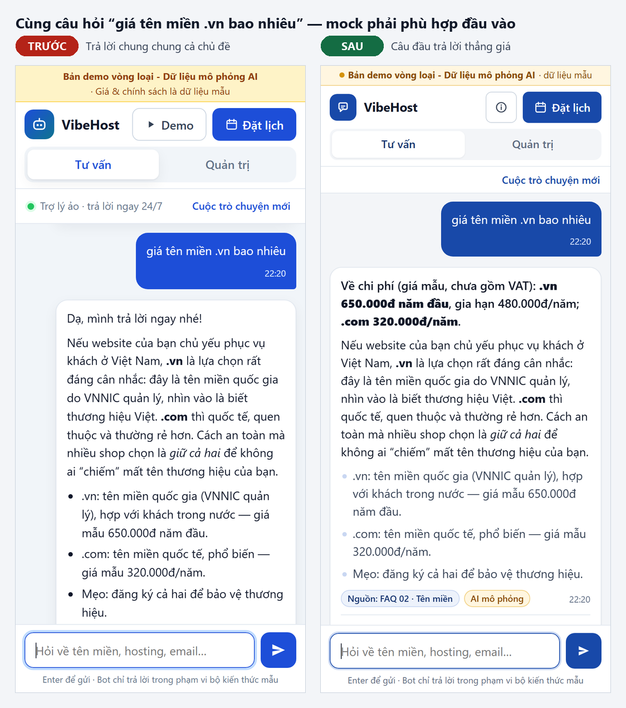
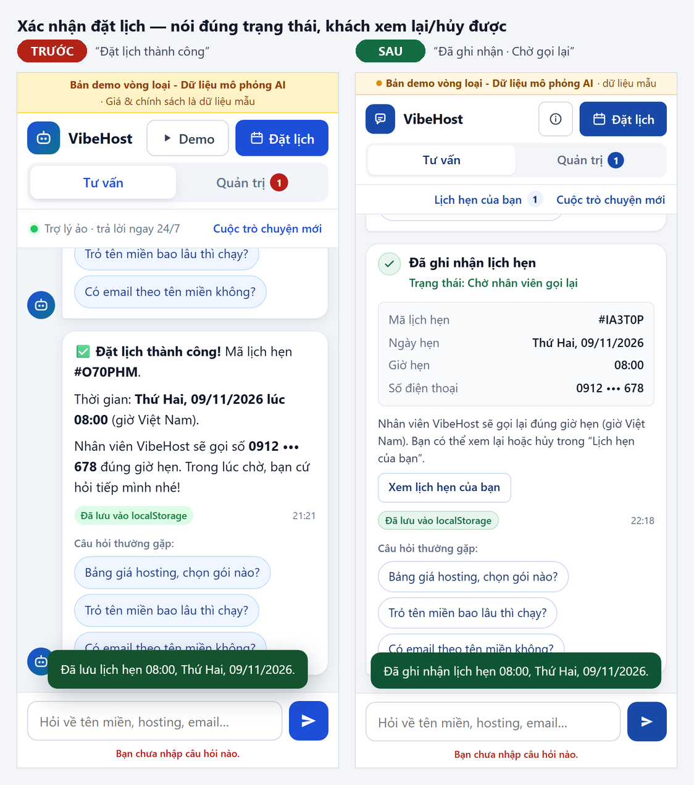
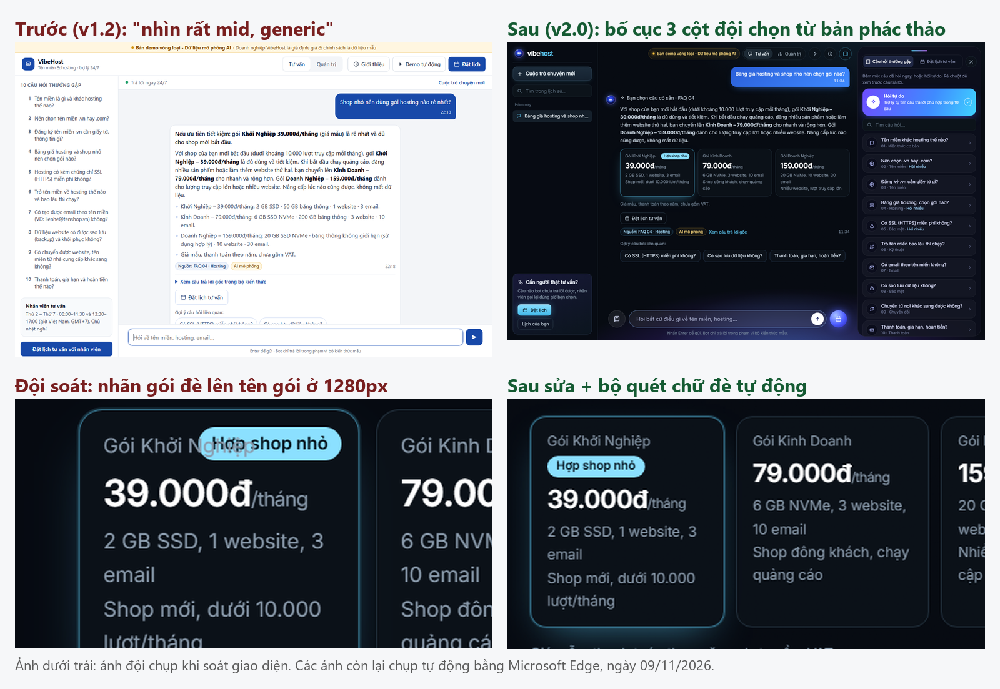

# Minh chứng dùng AI để xây dựng sản phẩm — Đội Vibe · Đề 4

**Công cụ:** Claude Code (trợ lý lập trình AI). **Cách làm:** đội giao yêu cầu và chốt quyết định; AI đọc đề, viết mã, **tự chạy thử bằng dữ liệu kiểu khách thật, phát hiện lỗi, đề xuất và sửa**; đội duyệt kết quả. Sáu mục chọn lọc dưới đây (4 đoạn hội thoại + 3 ảnh) đi theo trình tự *mục tiêu → yêu cầu cho AI → vấn đề phát hiện khi thử → yêu cầu sửa → kết quả kiểm tra lại*. Mọi con số là kết quả chạy thật ngày 08–09/11/2026.

**① Hiểu đề trước khi code.** Yêu cầu: *"hãy đọc kỹ trong file đề và research kỹ trên mạng về cuộc thi này, lên plan… để oneshot project"*. AI đọc 5 file PDF dạng ảnh (cắt thành 32 đoạn mới đọc được) và website BTC (đề 4, tiêu chí bảng B, mẫu README). **Phát hiện:** hồ sơ đội đang "Chưa gửi duyệt" trong khi cổng nộp ghi *chỉ đội đã xác thực mới lưu được bài*; BTC bắt buộc ghi *"Bản demo vòng loại - Dữ liệu mô phỏng AI"* nếu dùng mock; không có bảng giá chính thức của nhà tài trợ. **Quyết định của đội:** mock minh bạch (bảng B vẫn đạt tối đa), doanh nghiệp giả định "VibeHost", HTML/JS thuần chạy offline, deploy GitHub Pages.

**② Thử câu hỏi kiểu khách thật → bot trả lời SAI chủ đề.** Bộ kiểm tra AI tự viết lần đầu đạt 268/268 — đội yêu cầu thử thêm 40 câu tự nhiên. **Vấn đề:** *"hoàn tiền mất bao lâu"* bị trả lời bằng FAQ "trỏ tên miền" (cụm "mất bao lâu" bị tính điểm quá cao); *"chuyển tên miền .vn sang được không"* nhầm sang FAQ ".vn hay .com"; *"email gửi đi bị vào spam"* bị trả lời bằng FAQ "tạo email"; *"có hỗ trợ 24/7 không"* không hiểu. **Yêu cầu sửa:** hạ điểm cụm chung, thêm dấu hiệu ngoài phạm vi "spam" để chuyển nhân viên, thêm ý định "24/7". **Kiểm tra lại:** cả 4 câu đúng, thêm kiểm tra hồi quy. Ở vòng rà soát sau, chính lần sửa này lộ tác dụng phụ (*"tên miền .com giá bao nhiêu"* bị chuyển sang đặt lịch) và *"bảo mật dữ liệu khách hàng"* bị hiểu thành "mất dữ liệu" (bỏ dấu "bảo **mật** dữ liệu" chứa "**mất** dữ liệu") → sửa tiếp, thêm hồi quy.

**③ Ảnh — mock phải phù hợp đầu vào.** Đội yêu cầu: *"xem kỹ bảng tiêu chí, đủ hết chưa"*. AI đối chiếu 7 nhóm tiêu chí và 7 bài hướng dẫn của BTC, nhận ra: hỏi *giá* vẫn nhận cả đoạn so sánh chung (BTC: *"Mock phải phù hợp đầu vào"*). **Sửa:** mỗi FAQ có 2–4 câu trả lời trọng tâm theo ý con (giá, rẻ nhất, hết hạn, hoàn tiền, đã trỏ mà chưa vào được…), đặt lên đầu câu trả lời; giải thích lý do trong "Xem câu trả lời gốc". Kiểm tra: 14 câu theo ý con đều trả lời thẳng ý.

**④ Ảnh — thông báo phải nói đúng trạng thái.** Bài UI/UX của BTC nhấn mạnh *"Đã tiếp nhận yêu cầu" khác "Đã duyệt"* và hỏi *"người dùng có biết cách quay lại xem yêu cầu không?"*. **Vấn đề:** bản cũ báo "Đặt lịch thành công" và khách không xem lại/hủy được lịch. **Sửa:** thẻ xác nhận "Đã ghi nhận · Chờ nhân viên gọi lại" có mã lịch; thêm "Lịch hẹn của bạn" để xem và tự hủy (lịch đã hủy trả lại khung giờ). Thêm "Hiệu quả chatbot" ở quản trị để thấy giá trị bằng số liệu thật.

**⑤ Chạy trên trình duyệt thật & soát ảnh chụp.** AI viết kịch bản điều khiển Edge (320/390/1366px) bấm, gõ, đặt, hủy, xóa như người dùng và chụp ảnh để soát. **Vấn đề phát hiện:** số điện thoại hiển thị "0912 678\*" (ký tự "\*\*\*" xung đột định dạng in đậm); ô ngày kiểu Mỹ "11/09/2026" dễ hiểu nhầm tháng 9; câu lặp "khách của shop của bạn"; nút xác nhận bị khuất trên điện thoại; đầu trang chiếm quá nhiều chỗ; emoji và gradient trang trí. **Sửa** từng lỗi, mỗi lỗi kèm kiểm tra tự động để không quay lại. **Kết quả ở v1.2:** 341/341 kiểm tra logic, 60/60 kiểm tra giao diện, 0 lỗi console.

**⑥ Ảnh — làm lại giao diện theo góp ý của đội.** Đội nhận xét bản 1.2: *"nhìn rất là mid, không nổi bật, rất là generic"*, muốn hiệu ứng khi di chuột (*"cái gì nhìn theo"*, bong bóng mở lên). AI tìm ảnh tham khảo, vẽ 3 lượt phác thảo (đội chê lượt đầu *"vẫn bị AI slop"*), đội chốt: *"bố cục v2 có câu hỏi thường gặp và bubble nổi lên bên phải… phần đặt lịch ở bên phải trong v5… cho bật tắt"*. AI code lại: lịch sử trò chuyện bên trái, bảng FAQ/đặt lịch bên phải, linh vật có mắt nhìn theo con trỏ, thẻ gói hosting. **Vấn đề phát hiện khi chạy thử:** lớp phủ mờ đè lên bảng đặt lịch ở 1024px; nút ẩn bảng bị che ở 1280px; thanh trên chiếm 3 hàng trên điện thoại. Đội soát tiếp và chụp lỗi nhãn "Hợp shop nhỏ" đè lên tên gói → yêu cầu *"sửa một số lỗi ui tràn, đè chữ"*. AI viết bộ quét tự động mọi đoạn chữ (5 độ rộng × 10 trạng thái), **chạy trên bản cũ để chắc chắn bộ quét bắt được lỗi** (lần đầu bộ quét bỏ sót vì coi chữ bị che là "không hiển thị" → sửa lại), rồi sửa và chạy lại sạch. **Kết quả v2.0:** 341/341 kiểm tra logic, 73/73 kiểm tra giao diện (320 → 1920px), 0 lỗi console, demo tự động 90 giây.

**Bài học:** AI viết mã nhanh nhưng vẫn mắc lỗi khó thấy (chấm điểm từ khóa, định dạng hiển thị, ngữ pháp, câu chữ sai trạng thái); chỉ lộ ra khi **thử bằng dữ liệu thật, xem giao diện thật và đối chiếu từng tiêu chí**. Mỗi lần sửa đều kèm kiểm tra hồi quy.
